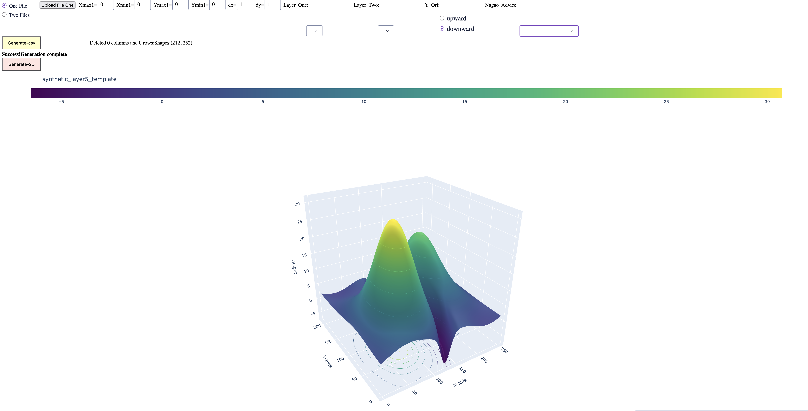
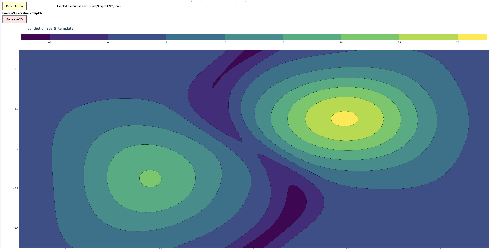

# Chikei Visualization Tool (Taisui)

A local Python web app built with Dash and Plotly for exploring terrain height data in interactive 3D surfaces and 2D contour plots. Download this repository, run the app, and open it in your browser. No online deployment is required.

## Output examples

### 3D surface



### 2D contours



## Features

- Visualize one dataset or compare two datasets side by side.
- Generate 3D surfaces and 2D contours from CSV height grids.
- Adjust height scaling and color maps.
- Set grid boundaries manually or use layer presets.
- Use Top View and Hide Coordinates for a single 3D plot.
- Load supported H-Fresh 2D `.xyznf` data with the corresponding water and f files.

## Download and run

Python 3.13 is recommended, matching the version used for this project. Dependencies are listed in `requirements.txt`.

1. On GitHub, choose **Code → Download ZIP**, extract the archive, and open a terminal in the extracted project folder. Alternatively, clone it:

   ```bash
   git clone https://github.com/Haku2023/chikei-visualization-taisui.git
   cd chikei-visualization-taisui
   ```

2. Create and activate a virtual environment:

   **macOS / Linux**

   ```bash
   python3 -m venv .venv
   source .venv/bin/activate
   ```

   **Windows PowerShell**

   ```powershell
   py -3.13 -m venv .venv
   .venv\Scripts\Activate.ps1
   ```

3. Install dependencies and start the app:

   ```bash
   python -m pip install -r requirements.txt
   python chikei-visualization-taisui.py
   ```

4. Open [http://127.0.0.1:8050](http://127.0.0.1:8050) in your browser. Keep the terminal running while using the app; press **Ctrl+C** to stop it.

The CSV is selected inside the app; it is not loaded automatically at startup.

## Try the included synthetic CSV

`synthetic_layer5_template.csv` contains entirely fictional terrain heights on a **212-row × 252-column** grid. It is provided for demonstrations without using the original terrain measurements.

1. Choose **Using .csv file** and **One File**.
2. Click **Upload File One** and select `synthetic_layer5_template.csv` from the project folder.
3. Leave **Layer_One** unselected (or clear it), then enter these fictional grid settings:

   | Field | Value |
   | --- | ---: |
   | Xmin1 | 0 |
   | Xmax1 | 1260 |
   | Ymin1 | 0 |
   | Ymax1 | 1060 |
   | dx | 5 |
   | dy | 5 |

4. Keep the default **downward** row orientation.
5. Click **Generate-csv** for 3D or **Generate-2D** for contours. Try changing the color map or height scale and generating the plot again.

The dimensions match Layer 5: `1260 / 5 = 252` columns and `1060 / 5 = 212` rows. **Selecting Layer 5 fills the app's existing geographic coordinates**, rather than the fictional bounds above. If you select a layer, enter the fictional values afterward; changing the layer again resets those fields.

See [SYNTHETIC_DATA.md](SYNTHETIC_DATA.md) for details about the template and coordinate handling. Label plots made from this file as synthetic demonstration data.

## Use your own data

### CSV format and boundaries

Provide a rectangular numeric matrix with **no header or index**. Each cell is a height; rows represent Y and columns represent X. Coordinates and layer identifiers are not stored in the CSV.

The app does not infer a layer from the filename or CSV contents. Enter the boundaries and spacing manually, or select a preset from the Python script's `layermapping` dictionary. For a regular grid:

- `(Xmax - Xmin) / dx` should equal the number of columns.
- `(Ymax - Ymin) / dy` should equal the number of rows.

The bounds describe cell edges; the plots use cell centers. Choose **upward** to reverse the CSV row order, or **downward** to keep it as read.

### Compare two files

Choose **Two Files**, upload each CSV, and configure the boundaries and spacing for both files. Click **Generate-csv** for side-by-side 3D plots or **Generate-2D** for contours. Top View and Hide Coordinates are available for single-file 3D visualization.

### H-Fresh files

Choose **Using .xyznf files**, upload the matching **water**, **xyzn**, and **f** files for H-Fresh 2D data, then click **Generate-xyznf**. For comparison, choose **Two Files** and upload both sets.

## Contributing

Issues and pull requests are welcome.

Author: baihaodong (haku), 2023–2026.

---

# 地形可視化ツール（Taisui）

DashとPlotlyで構築したローカル実行用のPython Webアプリです。リポジトリをダウンロードして起動すると、ブラウザで3D地形と2D等高線を操作できます。上の画像は出力例です。オンラインへのデプロイは不要です。

## ダウンロードと起動

Python 3.13を推奨します。

1. GitHubの **Code → Download ZIP** からダウンロードして展開し、プロジェクトフォルダでターミナルを開きます。Gitを使う場合：

   ```bash
   git clone https://github.com/Haku2023/chikei-visualization-taisui.git
   cd chikei-visualization-taisui
   ```

2. 仮想環境を作成して有効化します。

   **macOS / Linux**

   ```bash
   python3 -m venv .venv
   source .venv/bin/activate
   ```

   **Windows PowerShell**

   ```powershell
   py -3.13 -m venv .venv
   .venv\Scripts\Activate.ps1
   ```

3. 依存パッケージをインストールして起動します。

   ```bash
   python -m pip install -r requirements.txt
   python chikei-visualization-taisui.py
   ```

4. ブラウザで [http://127.0.0.1:8050](http://127.0.0.1:8050) を開きます。使用中はターミナルを起動したままにし、終了時は **Ctrl+C** を押してください。

CSVは起動時に自動読込されません。アプリ内で選択してください。

## 同梱の合成CSVを試す

`synthetic_layer5_template.csv` は、実測地形の代わりに使える架空の高さデータです。サイズは **212行（Y）×252列（X）** です。

1. **Using .csv file** と **One File** を選択します。
2. **Upload File One** から `synthetic_layer5_template.csv` を選択します。
3. **Layer_One** は未選択にして、以下の架空座標を手入力します。

   | 項目 | 値 |
   | --- | ---: |
   | Xmin1 | 0 |
   | Xmax1 | 1260 |
   | Ymin1 | 0 |
   | Ymax1 | 1060 |
   | dx | 5 |
   | dy | 5 |

4. 行方向は初期値の **downward** にします。
5. **Generate-csv** で3D、**Generate-2D** で等高線を表示します。色や高さ倍率を変更したら、再度生成してください。

グリッドのサイズと間隔はレイヤー5に対応しています。ただし、**Layer_Oneで5を選ぶと、Python内の既存の地理座標が入力されます**。架空座標を使う場合は、レイヤー選択後に上記の値を入力し直してください。その後レイヤーを変更すると値がリセットされます。

詳細は [SYNTHETIC_DATA.md](SYNTHETIC_DATA.md) を参照してください。このCSVの出力は合成データによるデモとして表示してください。

## 自分のデータを使う

CSVはヘッダー・インデックスなしの長方形の数値行列にします。各セルは高さ、行はY方向、列はX方向です。座標やレイヤー番号はCSVに含まれません。

アプリはファイル名や内容からレイヤーを判定しません。範囲と間隔を手入力するか、Pythonの `layermapping` 辞書にあるプリセットを選択します。`(Xmax - Xmin) / dx` が列数、`(Ymax - Ymin) / dy` が行数になるように設定してください。範囲はセルの外縁で、描画にはセル中心が使われます。**upward** は行順を反転し、**downward** は読み込んだ行順を維持します。

**Two Files** では各CSVと座標設定を指定し、**Generate-csv** または **Generate-2D** で比較できます。Top ViewとHide Coordinatesは単一ファイルの3D表示で利用できます。

H-Freshの2Dデータは **Using .xyznf files** を選び、対応する **water・xyzn・f** ファイルをアップロードして **Generate-xyznf** を押してください。

## 貢献

Issueやプルリクエストを歓迎します。

作者：白皓東（haku）、2023–2026。
